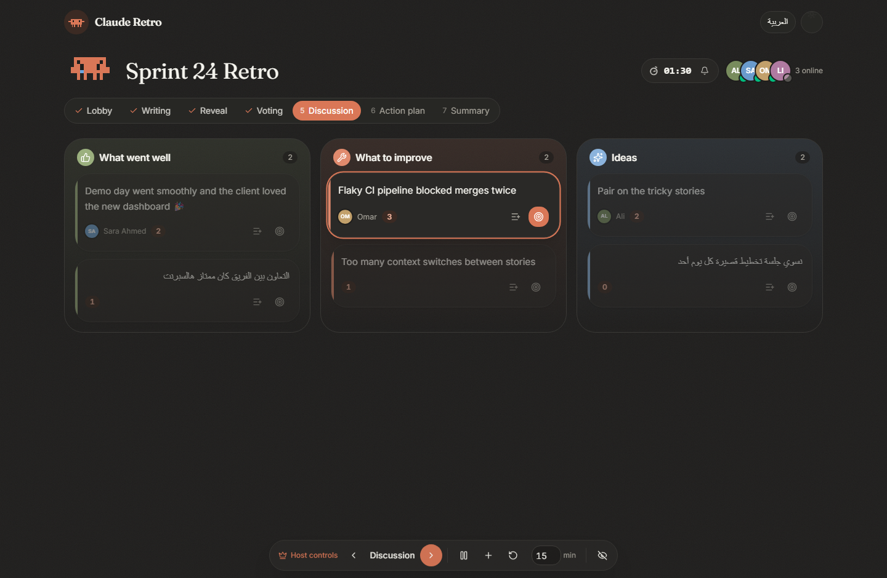
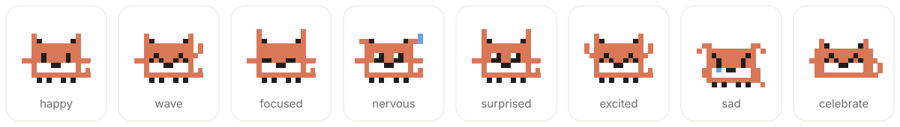
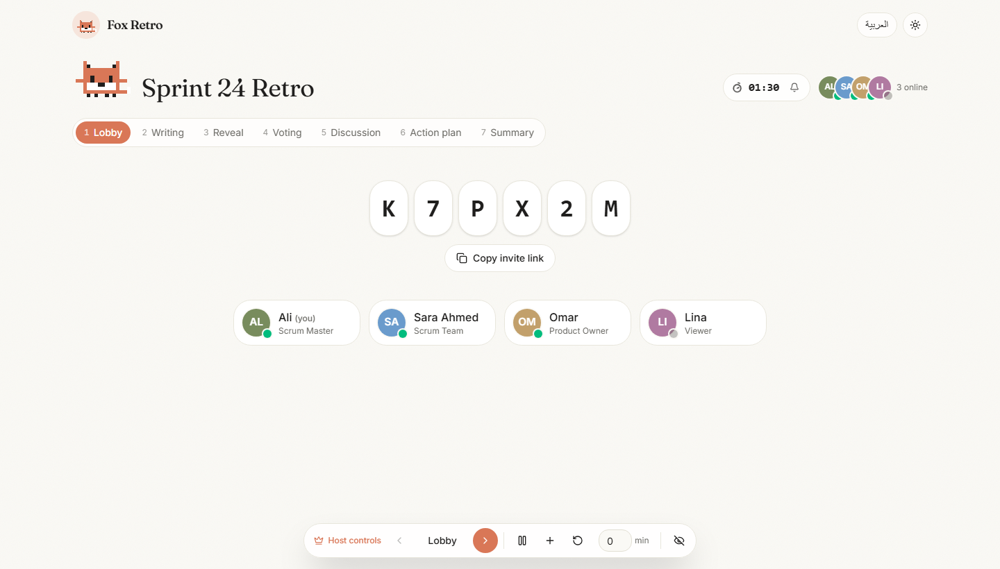
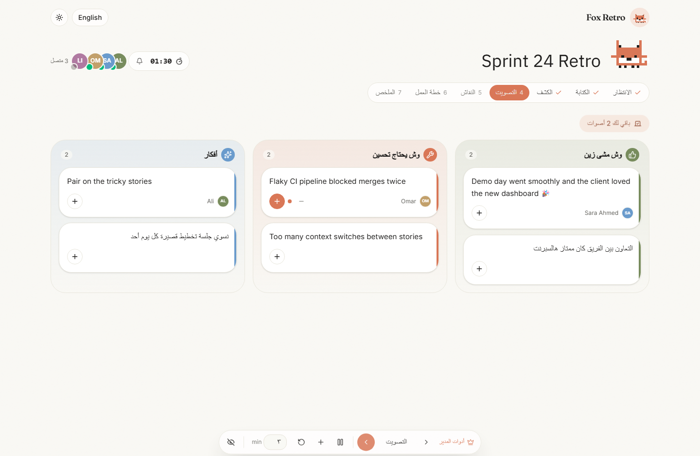
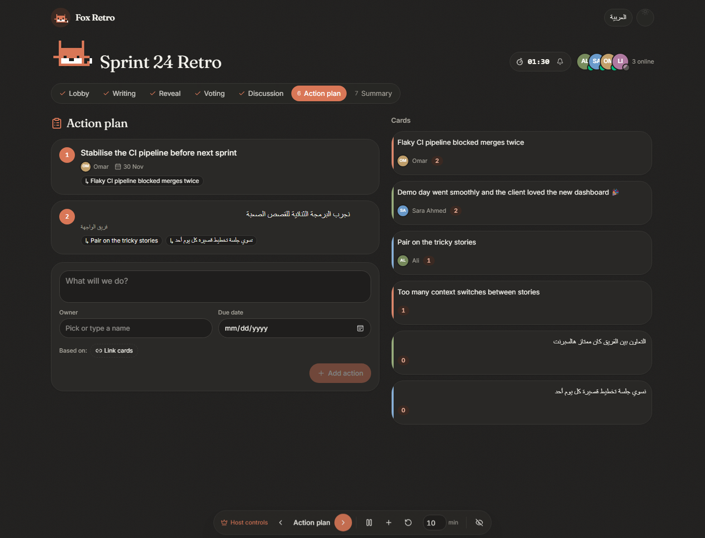
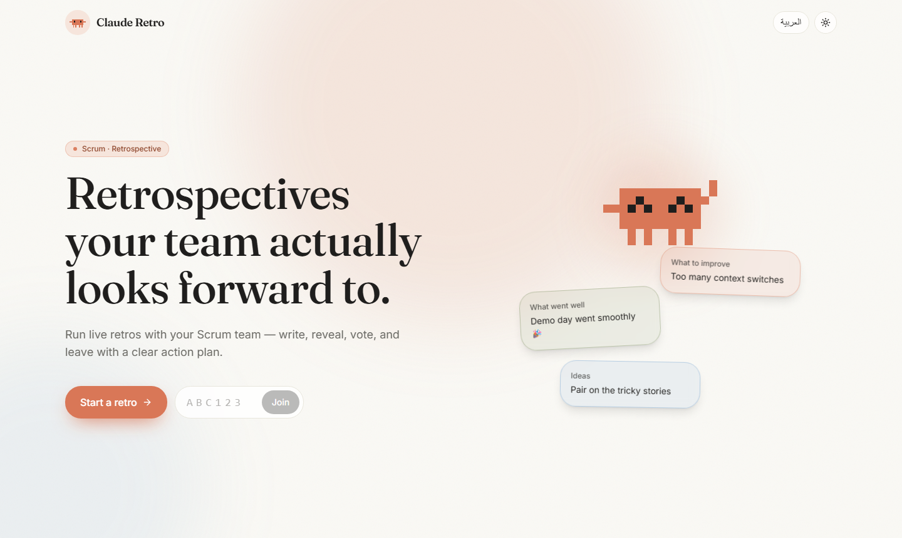

<div align="center">

<picture>
  <source media="(prefers-color-scheme: dark)" srcset="docs/assets/banner-dark.svg">
  
</picture>

<p>
  <a href="https://fox-retro.vercel.app"><b>Live demo</b></a> ·
  <a href="#-features">Features</a> ·
  <a href="#-how-a-retro-flows">How it flows</a> ·
  <a href="#-getting-started">Getting started</a>
</p>

<p>
  
  
  
  
  
  
  
</p>

</div>

**Fox Retro** is a real-time Scrum retrospective board. The Scrum Master runs the session: phases, timer, and the final action plan. Everyone else joins from their own device with just a name and a role. It's warm, calm, and quietly delightful, with a pixel fox who reacts to how the retro is going.

<div align="center">
  
</div>

## ✨ Features

|  |  |
|---|---|
| ⚡ **Live on every screen** | Cards, votes, phases and the timer sync instantly across devices with Supabase Realtime. The timer uses server time, so two devices never disagree. |
| 🦊 **A fox with feelings** | The pixel fox wags its tail in the lobby, perks its ears while you write, flattens them in the last 30 seconds, droops over "what to improve", and throws a party at the end. |
| 🕶️ **Honest by design** | Cards stay private until reveal, authors stay anonymous (even to the host) unless shown, and votes stay hidden until discussion. All of it is enforced in the database. |
| 🗳️ **Dot voting** | 3 votes each, and you can stack them on one card. Totals count up when discussion starts. |
| 🎯 **Facilitation tools** | Phase stepper, a synced timer (start, pause, +1 min, reset, per-phase durations), focus mode, and an optional chime. |
| 🔗 **Actions with receipts** | Every action item links back to the cards it came from. Turn any card into an action during discussion. |
| 🌍 **Arabic and English** | Each person picks their language. The whole UI mirrors properly in RTL, animations included. |
| 🌗 **Light and dark** | Warm cream and charcoal palettes, with smooth theme transitions. |
| 📋 **Wrap-up** | A summary page with stats, confetti, copy-as-Markdown and print-to-PDF. |

### Meet the crew

<picture>
  <source media="(prefers-color-scheme: dark)" srcset="docs/assets/moods-dark.svg">
  
</picture>

## 🔁 How a retro flows

```text
 Lobby ─► Writing ─► Reveal ─► Voting ─► Discussion ─► Action plan ─► Summary
  join     private    cards     3 dots    focus +        owner, date,   stats,
  by code  cards      flip in   each      totals         linked cards   export
```

Only the host moves between phases. The timer running out never moves the session forward on its own.

| Role | Writes cards | Votes | Runs the session |
|---|:---:|:---:|:---:|
| Scrum Team | ✅ | ✅ | — |
| Product Owner | ✅ | ✅ | — |
| Scrum Master | ✅ | ✅ | only the retro's creator |
| Viewer | — | — | — |

<table>
  <tr>
    <td width="50%"></td>
    <td width="50%"></td>
  </tr>
  <tr>
    <td align="center"><sub>Lobby: share the code, watch people pop in</sub></td>
    <td align="center"><sub>Voting in Arabic: the full RTL layout</sub></td>
  </tr>
  <tr>
    <td width="50%"></td>
    <td width="50%"></td>
  </tr>
  <tr>
    <td align="center"><sub>Action plan: every item links to the cards behind it</sub></td>
    <td align="center"><sub>Landing page in light mode</sub></td>
  </tr>
</table>

## 🔐 Privacy, enforced by the database

These rules come from Postgres Row-Level Security and `SECURITY DEFINER` RPCs, not from hiding things in the UI:

- **While writing**, nobody can read anyone else's cards. Others see only per-person counts.
- **After reveal**, authors are hidden unless the host turns on *Show authors*, and that includes the host. Other people's card times are never returned, so authors can't be worked out from timing.
- **Votes** are capped at 3 per person (race-safe) and totals stay hidden until discussion.
- **Viewers** are read-only. **Anonymous users** can't create retros. Only the **host** can change phases, run the timer, or write the action plan.
- Hosting can be limited to your company's email domains (see below).

`supabase/tests/rls_smoke.sql` checks all of this against a real database inside a transaction that rolls back.

## 🚀 Getting started

**Prerequisites:** Node 20+ and a free [Supabase](https://supabase.com) project.

```bash
git clone https://github.com/A-Alhoshan/fox-retro.git
cd fox-retro
npm install
cp .env.example .env.local   # then fill in your Supabase URL and anon key
npm run dev
```

**Supabase setup**

1. Run `supabase/migrations/*.sql` in order in the SQL editor.
2. Go to **Authentication → Sign In / Providers** and enable **Email** and **Allow anonymous sign-ins**.
3. Go to **Authentication → URL Configuration**. Set the Site URL to your deployment and add `<url>/auth/callback` (plus `http://localhost:3000/auth/callback`) as redirect URLs.
4. *(Optional)* Only let your company host:
   ```sql
   insert into public.host_domains (domain) values ('yourcompany.com');
   ```
5. *(Recommended for teams)* Set up custom SMTP. Supabase's built-in sender only emails your Supabase team members and allows a few emails an hour. A free option with no domain is a dedicated Gmail account:
   - Turn on 2-Step Verification, then create an **App password** (Google Account → Security).
   - In **Authentication → Emails → SMTP Settings**: host `smtp.gmail.com`, port `465`, username and sender email = the Gmail address, password = the app password, sender name `Fox Retro`.
   - Raise **Authentication → Rate Limits → emails per hour** (Gmail allows roughly 500 a day).
   - Keep the app password out of the repo and out of Vercel. It only lives in Supabase.

**Deploy:** import the repo into Vercel and set `NEXT_PUBLIC_SUPABASE_URL` and `NEXT_PUBLIC_SUPABASE_ANON_KEY`. Never put the service-role key on Vercel.

## 🧪 Development

```bash
npm test             # 141 unit and component tests (Vitest + Testing Library)
npm run test:int     # RLS integration tests (needs SUPABASE_SERVICE_ROLE_KEY in .env.local)
npm run build        # production build
```

Dev-only previews, which return 404 in production:
- `/dev/mascot`: every mood
- `/dev/board?phase=voting`: any phase with sample data

```text
src/
├─ app/                 routes: landing, login, dashboard, /r/[code], summary
│  └─ r/[code]/host-actions.ts   host-only Server Actions
├─ components/
│  ├─ mascot/           pixel fox sprites + animated <Mascot>
│  └─ retro/            board, cards, timer, host bar, action plan, summary
├─ i18n/                en / ar messages + RTL-aware provider
└─ lib/domain/          pure logic: timer, votes, phases, mood, export
supabase/migrations/    schema, RLS, RPCs
```

## 📄 Notes

Made by Ali. Built with ❤️ and [Claude Code](https://claude.com/claude-code).
